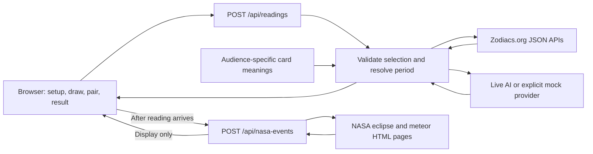

# Architecture

## Application and data flow

One Next.js 16 application uses React 19 and TypeScript for the interface and two Node server routes: readings and NASA sky highlights. There is no database, authentication system, or separate backend service. Card content is stored in versioned files; credentials stay in server environment variables.



| Area | Responsibility |
| --- | --- |
| `src/features/reading/` | Client flow and state, API calls, background sky, and cursor effects |
| `src/app/` | Root page, layout, global styling, and transparent SVG favicon |
| `src/app/api/readings/` and `src/app/api/nasa-events/` | Separate HTTP entry points for readings and NASA highlights |
| `src/contracts/catalog.ts` | Question and card IDs, audiences, period metadata, and card types |
| `src/contracts/reading.ts` | Request validation and response types |
| `src/content/` and `public/cards/` | Audience labels, 32 cards with audience-specific meanings, and 33 deck WebP assets |
| `src/domain/` | Shuffling, calendar-month arithmetic, and event selection |
| `src/server/` | Reading orchestration, Zodiacs.org retrieval, AI configuration, prompt, and output validation |
| `src/server/nasa/` | Allowlisted NASA retrieval, dated HTML parsing, and period filtering |
| `tests/` | Offline contract/provider tests and browser journeys |

Browser modules must not import server modules. The production prompt is defined in `src/server/oracle-prompt.ts`; the editorial rules are in [product.md](product.md).

## Interface and assets

Bodoni Moda is used for headings, question text, and card titles, with Bodoni 72, Didot, and Georgia fallbacks. Inter Tight is used for body text, buttons, cues, summaries, and navigation, with Avenir Next, Avenir, and Arial fallbacks. The local Witch font is reserved for “Malina” in the wordmark. Shared CSS font variables keep the draw, pair, and reading screens consistent. Bodoni Moda and Inter Tight load through a Google Fonts stylesheet; the system stacks remain available if that request fails. Witch is served from `public/fonts/witch.otf`.

The welcome illustration uses `public/box-cover.webp` and seven fixed decorative cards from the shared deck. It does not select cards for the reading. `src/app/icon.svg` supplies the transparent crystal-ball favicon through Next.js metadata conventions. `CelestialSky` and `MagicTrail` provide decorative effects; they do not participate in reading generation.

## Reading pipeline

Reading state stays in `ReadingExperience` component state; reloading the page discards the selection and result. There is no browser or server persistence.

The browser uses a Fisher–Yates shuffle with `Math.random()` once per new deck. Click order assigns **Read the situation** and **What to do** roles. Desktop uses two curved fans of 16 cards; phones use four fans of eight. A draw keeps every card in its shuffled position, leaves a gap, and shows the selected face in a viewport-fixed overlay before moving it below the viewport. Input stays locked through that sequence. Reduced-motion mode shows the face without spatial movement for a short pause. After the second card exits, a selected-pair stage replaces the deck; only its reveal button requests a reading. Retrying preserves the ordered selection but makes a new reading request. Restarting or leaving the component cancels pending draw work. This entertainment app validates card IDs and uniqueness; it does not prevent a caller from deliberately choosing another valid pair.

The server derives the audience from the validated question ID. It selects the answer meaning of the first card and recommendation meaning of the second card for that audience. Other audience meanings are not sent to the model.

Periods start at midnight UTC on the request date and end after 1, 3, or 12 calendar months, clamping month ends and leap days. Ranges include the start and exclude the end. The interface shows the last included date. Fixed-period questions and exact labels are documented in [product.md](product.md).

## Calendar

Every reading, including mock readings, requests these Zodiacs.org endpoints for each UTC year touched by the period:

- `https://zodiacs.org/api/v1/retrogrades/{year}.json`
- `https://zodiacs.org/api/v1/moon-phases/{year}.json`

Requests run concurrently with `cache: "no-store"`; one five-second deadline covers retrieval and parsing. The importer validates schemas, requested years, coverage, station boundaries, and duplicates, and joins cross-year intervals. A source or validation failure returns `calendarStatus: "unavailable"` with no events. There is no runtime snapshot fallback.

Selection keeps at most three events overlapping the reading range, including intervals already in progress. Candidates are ranked by curated workplace relevance, with Mercury ranked highest. Each next selection prefers an unused planet or moon-phase type. Ranges of at least 180 days apply this preference within each of three time buckets to preserve coverage across the period; a bucket may repeat a family if it has no alternative. The response also carries `availableEvents`, the deduplicated chronological list of all verified events overlapping the requested period for the expandable calendar. The interface initially shows the selected three events; `View all events` reveals the full list and `Show fewer events` restores the selection without another API request. The AI receives only the selected `events` subset. Symbolic workplace interpretations are curated in the importer; they are not scientific forecasts.

The checked calendar snapshot and `calendar-fixture.ts` are used by offline tests, not the production route. To refresh the fixture intentionally:

```bash
npm run calendar:refresh -- 2026 2027 2028
```

Review the changed data before committing. Public event metadata retains source dates. The interface lists names, dates or date ranges, and source links, and displays `Data: Zodiacs.org — https://zodiacs.org` for CC BY 4.0 attribution.

## NASA sky highlights

The final screen calls `/api/nasa-events` after a successful reading, using the returned period. This works in live and mock modes. NASA is fetched separately and never enters the oracle prompt.

The server reads official HTML pages rather than a unified NASA calendar API:

- Annual eclipse summaries: `https://eclipse.gsfc.nasa.gov/OH/OH{year}.html` for each year touched by the period.
- NASA Science meteor pages: `https://science.nasa.gov/solar-system/meteors-meteorites/{shower}/`, for Quadrantids, Lyrids, Perseids, Orionids, Leonids, and Geminids.

Requests run concurrently with `cache: "no-store"`, redirects disabled, and a shared four-second deadline. Eclipse entries must name the date and eclipse type together. Meteor peaks must have an explicit year, or a single unambiguous year in the published Active row. A prior year's dates are never repeated into a future year. Parsing is tied to those page structures; changed or unavailable sources can yield fewer events.

The route deduplicates events, filters for overlap, and returns all verified matches chronologically. The interface initially shows the nearest three, with independent expand/collapse controls. Each title links directly to its NASA source; general visibility notes do not use an observer location. NASA `date` and optional `endDate` are date-only values with an inclusive end, unlike the reading's end-exclusive timestamps.

The browser allows six seconds for this separate request and cancels it on restart or unmount. Failed sources are omitted while successful sources remain. An empty response or request failure hides the section without affecting the reading. There is no snapshot fallback or guarantee of complete year-ahead coverage.

## Oracle

`ORACLE_MODE=mock` is the default. It uses deterministic sample text from card meanings and, if available, the first selected event. It is visibly labeled and does not reproduce the live model's prose style.

Live mode uses the Responses API with Structured Outputs through the OpenAI SDK. `OPENAI_API_KEY` is required; `OPENAI_MODEL` defaults to `gpt-6-luna`. `OPENAI_BASE_URL` optionally selects an OpenAI-compatible gateway and must be an HTTPS URL without embedded credentials, query, or fragment. Model availability is provider-specific. Setup is in [How to Run](../README.md#how-to-run).

Each call has a 20-second timeout, no SDK retries or tools, `store: false`, a 1,200-output-token limit, and `reasoning.effort: "none"`. The configured provider/model must support these Responses API options. Logs contain status, duration, and usage rather than prompts or credentials.

The model receives the audience, exact question, resolved dates, card names and role-specific meanings, and selected events with dates, interpretations, and sources. It writes both complete paragraphs with broad temporal language. The internal structured output has `answer`, `recommendation`, and nullable `cosmicReferences` containing `{ eventId }` objects. Validation checks non-empty paragraphs of at most 800 characters each and unique, known event IDs overlapping the reading period. Events require at least one reference; no events require null references.

The server trims outer whitespace but does not append or rewrite prose. Live responses retain `cosmicNote: null` for public contract compatibility; the interface renders `answer` and `recommendation`. Reference validation does not prove that every claim or timing phrase is semantically correct. The T1A-only scope and style are prompt rules and still need editorial testing. A failed live call returns an error, never a mock reading.

## HTTP API

### Readings

`POST /api/readings` accepts JSON:

```json
{
  "questionId": "employee-performance-review",
  "periodId": "three-months",
  "answerCardId": "the-adaptability",
  "recommendationCardId": "the-reflection"
}
```

Example request against a running local app:

```bash
curl http://localhost:3000/api/readings \
  -H 'Content-Type: application/json' \
  -d '{"questionId":"employee-performance-review","periodId":"three-months","answerCardId":"the-adaptability","recommendationCardId":"the-reflection"}'
```

| Response field | Meaning |
| --- | --- |
| `answer`, `recommendation` | Text shown as Read the situation and What to do |
| `cosmicNote` | Compatibility field; null in live mode, may contain text in mock mode |
| `request` | Validated question, period, and ordered card IDs |
| `period` | Resolved UTC `start` and exclusive `end` |
| `events` | Up to three selected events supplied to the oracle, with dates, interpretation, and source |
| `availableEvents` | All verified events overlapping the period, deduplicated and chronological; optional for older clients |
| `meta.mode` | `mock` or `live` |
| `meta.calendarStatus` | `available` or `unavailable` |

- `200`: reading generated. An available but empty calendar and an unavailable calendar both allow card-only output, with different explanatory UI messages.
- `400`: `INVALID_REQUEST` for malformed JSON, extra fields, unknown IDs, duplicate cards, or incompatible question/period choices.
- `503`: `READING_FAILED` for configuration or oracle failure; the user can retry with the same cards.

Errors have shape `{ "error": { "code": "...", "message": "..." } }`. The browser request timeout is 30 seconds. Shared types in `src/contracts/reading.ts` are the implementation source of truth.

### NASA highlights

`POST /api/nasa-events` accepts the resolved reading period, with no additional fields:

```json
{
  "start": "2026-10-16T00:00:00.000Z",
  "end": "2027-10-16T00:00:00.000Z"
}
```

- `200`: `{ "events": [...] }`, possibly empty or partial when sources fail or have no published matches.
- `400`: `{ "events": [] }` for malformed input or an unsupported range. The route guard requires increasing timestamps, a span no longer than 367 days, and years within 1900–2100. The product itself requests at most twelve calendar months.

Each `NasaSkyEvent` contains `id`, `name`, `kind` (`solar-eclipse`, `lunar-eclipse`, or `meteor-shower`), `date`, optional inclusive `endDate`, `visibility`, and `source` with `name` and `url`. This is a separate response, not a field in `ReadingResponse`, and it does not use the reading route's `ApiError` envelope.

## Deployment

Use a Node-capable Next.js host; static-only hosting cannot execute the reading route. Configure the server environment from `.env.example`, allow outbound HTTPS to Zodiacs.org, both NASA hosts listed above, and the configured AI provider, and set the hosting request timeout above 25 seconds to cover both provider budgets. Configure request and spending limits at the hosting/provider level before a public live demo; the application does not implement authentication or rate limiting.

Build and verification commands are in the [README](../README.md). A shared deployment URL has not been documented. Delivered features and planned product development are summarized in the [project write-up](project-overview.md).
