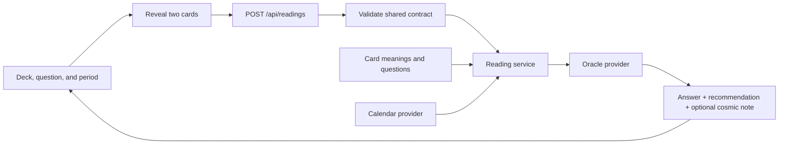

# Starter architecture

## Decision

Use one Next.js application with React and TypeScript. The browser displays the experience; a server route builds readings. There is no database, account system, or separate backend deployment in the MVP. Card content lives in versioned files. External credentials must stay in server environment variables.

This starter is runnable without credentials. It intentionally uses a deterministic mock oracle and an unavailable calendar provider. It does not contain a live AI integration or verified astrological data.

## Flow



The browser shuffles the shared card IDs once and reveals cards in the user's click order. The first reveal is the answer and the second is the recommendation. A failed reading request retries the same pair. The server validates IDs and rejects duplicate cards; this entertainment MVP does not try to prevent a user from deliberately submitting another valid pair.

## Boundaries and ownership

| Area | Owner | Purpose |
| --- | --- | --- |
| `src/features/reading/` | Frontend | Reading interaction, browser API client, presentation |
| `src/app/page.tsx`, `layout.tsx`, `globals.css` | Frontend | Page shell and visual design |
| `src/app/api/readings/` | Backend | HTTP validation and errors |
| `src/server/` | Backend | Reading orchestration and external providers |
| `src/domain/` | Backend | Shared pure deck, period, and event algorithms |
| `src/content/`, `public/cards/` | Content | Meanings, questions, illustrations, and editorial examples |
| `src/contracts/` | Shared; backend coordinates changes | Stable identifiers and request/response definitions |
| Root configuration and lockfile | Frontend/integration owner | Tooling, dependencies, and deployment |

The dependency direction is `UI -> contracts/domain/content` and `API -> service -> providers/domain/content`. Browser modules must not import from `src/server`. Keep provider SDKs and secrets out of content and shared contracts.

## Stable HTTP contract

`POST /api/readings`, JSON body:

```json
{
  "questionId": "employee-project-on-time",
  "periodId": "one-month",
  "answerCardId": "the-tower",
  "recommendationCardId": "the-magician"
}
```

`questionId` identifies one of the Employee Arcana or Leadership Arcana questions. The response contains `answer`, `recommendation`, nullable `cosmicNote`, the original `request`, the resolved `period`, the selected `events`, and `meta` with oracle mode and calendar status. The exact types live in `src/contracts/reading.ts`; use them rather than creating a second schema.

- `200`: reading generated; `meta.mode` is `mock` or `live`.
- `400`: `{ "error": { "code": "INVALID_REQUEST", "message": "..." } }`.
- `503`: `{ "error": { "code": "READING_FAILED", "message": "..." } }`.
- A calendar outage may still produce a card-only reading, marked `calendarStatus: "unavailable"`.
- A live AI failure must never silently return sample text.

## Dates and events

The server starts the range at midnight UTC on the request date. Month periods use calendar-month arithmetic with month-end clamping (January 31 + one month becomes February 28 or 29). The year period is twelve calendar months. All ranges are start-inclusive and end-exclusive. The response is the authoritative resolved period.

Calendar providers must normalize dates to ISO UTC, retain source URLs, and indicate incomplete or unavailable coverage. An available empty result means the provider actually covers the period and found no events. The initial unavailable provider makes no such claim.

Event selection includes intervals already in progress at the start date and excludes events beginning at the end boundary. A null event end represents an instant. The starter takes the first three overlapping events chronologically; topic-based ranking is optional later work.

The backend track should validate provider responses and live model output before exposing them through this contract. Each cosmic claim must be grounded in the supplied events. The starter's tests validate plumbing, not the factual quality of a future external provider.

## Content contract

All 32 IDs are fixed in `src/contracts/catalog.ts`: the 22 Major Arcana and ten selected Minor Arcana. Each card entry in `src/content/cards.ts` has a name, an image path, an answer meaning, and a recommendation meaning. Edit meanings and artwork without changing IDs.

Placeholder images are 600 by 900 SVGs (2:3). Final artwork may be PNG or WebP with the same ratio. Update the image path in the catalog when changing the extension. Render titles in the UI. The shared back is `public/cards/back.svg`; coordinate with the frontend owner if its path changes.

## Implementation sequence

1. All contributors install and run this exact starter revision.
2. Frontend refines the experience against the mock provider.
3. Backend implements verified calendar and live oracle adapters behind the existing interfaces.
4. Content replaces placeholder art and refines meanings and voice examples.
5. Integrate working slices on day 1, then refine and rehearse on day 2.

Deploy as one Node-capable Next.js service (for example, Vercel). Static-only hosting cannot run the reading route. Deployment itself is not configured in this starter.
