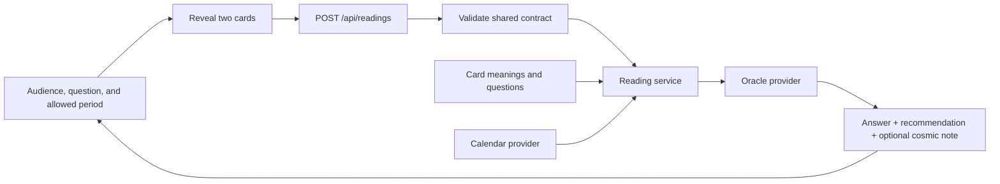

# Starter architecture

## Decision

Use one Next.js application with React and TypeScript. The browser displays the experience; a server route builds readings. There is no database, account system, or separate backend deployment in the MVP. Card content lives in versioned files. External credentials must stay in server environment variables.

This application is runnable without credentials. It defaults to a deterministic mock oracle, while every reading fetches source-validated Zodiacs.org calendar data at request time. A server-only live OpenAI oracle is available through explicit environment configuration; it is fake-tested but awaits verification with a project key.

## Scope update and migration status

The target experience has Employee and Leadership audiences with six questions each, three periods (one month, three months, one year), and one shared 32-card deck. Three questions have fixed periods. Exact labels, IDs, and restrictions are defined in [product.md](product.md). The shared contract and backend validation have migrated; audience grouping and period locking remain frontend work. The current 22-card catalog is provisional until the content owner supplies the final manifest.

Coordinate one shared migration of question/period identifiers, audience metadata, validation, UI defaults, fixtures, and examples. Developer 3 determines the final 32-card composition and artwork; use their manifest when migrating card IDs. No additional audience-specific deck or authentication system is needed.

## Flow



The browser shuffles the shared card IDs once and reveals cards in the user's click order. The first reveal is the answer and the second is the recommendation. A failed reading request retries the same pair. The server validates IDs and rejects duplicate cards; this entertainment MVP does not try to prevent a user from deliberately submitting another valid pair.

## Boundaries and ownership

| Area | Owner | Purpose |
| --- | --- | --- |
| `src/features/reading/` | Frontend | Reading interaction, browser API client, presentation |
| `src/app/page.tsx`, `layout.tsx`, `globals.css` | Frontend | Page shell and visual design |
| `src/app/api/readings/` | Backend | HTTP validation and errors |
| `src/server/` | Backend | Reading orchestration and external providers |
| `src/domain/` | Backend | Shared pure deck, period, and event algorithms |
| `src/content/`, `public/cards/` | Content | Meanings, questions, illustrations, and editorial examples |
| `src/contracts/` | Shared; backend coordinates changes | Stable identifiers and request/response definitions |
| Root configuration and lockfile | Frontend/integration owner | Tooling, dependencies, and deployment |

The dependency direction is `UI -> contracts/domain/content` and `API -> service -> providers/domain/content`. Browser modules must not import from `src/server`. Keep provider SDKs and secrets out of content and shared contracts.

## Target HTTP contract

`POST /api/readings`, JSON body:

```json
{
  "questionId": "employee-jira-hours",
  "periodId": "one-year",
  "answerCardId": "the-tower",
  "recommendationCardId": "the-magician"
}
```

The field structure stays unchanged. This example is accepted by the current backend and uses revised question/period IDs with illustrative existing card IDs. The final card IDs depend on the agreed manifest.

Each question has authoritative audience metadata and allowed period IDs in the shared catalog. The server derives audience from the validated question ID and passes it to the oracle. No separate audience field is needed in the HTTP request. Reject unsupported question-period combinations rather than silently changing the requested period.

The response contains `answer`, `recommendation`, nullable `cosmicNote`, the original `request`, the resolved `period`, the selected `events`, and `meta` with oracle mode and calendar status. The exact types live in `src/contracts/reading.ts`; use them rather than creating a second schema. Event sources identify Zodiacs.org; the interface should display `Data: Zodiacs.org — https://zodiacs.org` for CC BY 4.0 attribution when calendar data is shown.

- `200`: reading generated; `meta.mode` is `mock` or `live`.
- `400`: `{ "error": { "code": "INVALID_REQUEST", "message": "..." } }`.
- `503`: `{ "error": { "code": "READING_FAILED", "message": "..." } }`.
- A calendar outage may still produce a card-only reading, marked `calendarStatus: "unavailable"`.
- A live AI failure must never silently return sample text.

## Dates and events

The server starts the range at midnight UTC on the request date. Resolve the three period IDs explicitly to 1, 3, or 12 calendar months, with month-end clamping (including February 29). All ranges are start-inclusive and end-exclusive. These are rolling periods, not the next calendar year or quarter. The response is the authoritative resolved period.

The Jira-hours and company-outlook questions require `one-year`; the changing-priorities question requires `three-months`. The UI sets and locks these periods, and the server rejects mismatches. The other nine questions allow all three choices.

The runtime calendar provider fetches both Zodiacs.org source families for every UTC year touched by the period, concurrently and without caching. One five-second deadline covers requests and JSON parsing. It validates that each response declares the requested year, then uses the shared importer to normalize dates, join cross-year intervals, retain source URLs, and verify full coverage. Any timeout, network or HTTP error, malformed data, wrong year, or incomplete coverage returns an unavailable result with no snapshot fallback. An available empty result means the provider covered the period and found no events.

Event selection includes intervals already in progress at the start date and excludes events beginning at the end boundary. A January 1 end boundary does not require that next UTC year's source file. A null event end represents an instant. Selection returns at most three events. Short ranges rank workplace-relevant events deterministically. Ranges longer than 180 days divide the requested period into thirds and choose the strongest candidate in each populated third, then fill empty slots by relevance. Cross-year intervals are merged during import, and the provider claims availability only when fetched sources cover every instant in the requested range.

The backend validates provider responses and live model output before exposing them through this contract. Model event references must match supplied event IDs; the server adds authoritative event names and dates. Automated tests cover this boundary with injected fakes, but factual tone and editorial quality still require live review with a project key.

## Content contract

The target is one shared deck with 32 unique IDs, with exactly two draws for every audience and period. The current 22 IDs in `src/contracts/catalog.ts` are provisional. Developer 3 (Content) decides the card composition and artwork and supplies the manifest. Frontend/backend coordinate its technical integration, then update contracts, content, images, and tests together. Preserve the integrated IDs. Do not impose creative approval gates on Developer 3.

Each entry in `src/content/cards.ts` has a name, an image path, an answer meaning, and a recommendation meaning. Question content must expose audience and allowed-period metadata so UI choices and backend validation use the same rules.

Placeholder images are 600 by 900 SVGs (2:3). Final artwork may be PNG or WebP with the same ratio. Update the image path in the catalog when changing the extension. Render titles in the UI. The shared back is `public/cards/back.svg`; coordinate with the frontend owner if its path changes.

## Integration status

The question and period contract, fixed-period validation, request-time calendar provider, event selection, explicit oracle modes, grounded Structured Outputs adapter, controlled timeouts, and public error mapping are implemented. The checked calendar JSON is an offline fixture rather than a runtime fallback. The backend path is covered across all 36 question-period combinations with injected offline dependencies.

Remaining work is cross-track: frontend audience grouping and fixed-period controls, the content owner's final 32-card manifest and artwork, shared deployment, and live quality/latency verification with a project key. See [backend-handoff.md](backend-handoff.md) for the integration contract.

Deploy as one Node-capable Next.js service (for example, Vercel). Static-only hosting cannot run the reading route. Set the host request timeout above 25 seconds so the five-second calendar budget and subsequent 20-second oracle budget can finish with controlled responses. Deployment itself is not configured in this starter.
