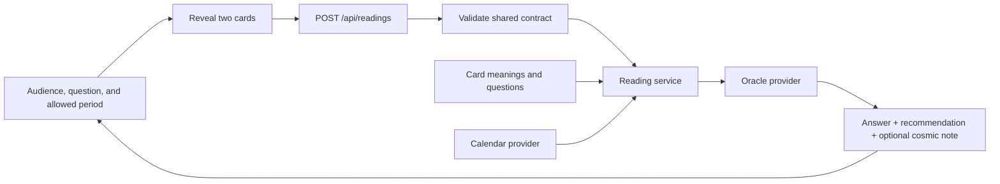

# Starter architecture

## Decision

Use one Next.js application with React and TypeScript. The browser displays the experience; a server route builds readings. There is no database, account system, or separate backend deployment in the MVP. Card content lives in versioned files. External credentials must stay in server environment variables.

This starter is runnable without credentials. It intentionally uses a deterministic mock oracle and an unavailable calendar provider. It does not contain a live AI integration or verified astrological data.

## Scope update and migration status

The target experience now has Employee and Leadership audiences with six questions each, three periods (one month, three months, one year), and one shared 32-card deck. Three questions have fixed periods. Exact labels, IDs, and restrictions are defined in [product.md](product.md). The 32-card manifest and artwork are integrated; the current code still has four ungrouped questions and two periods. This document distinguishes the target contract from that runnable legacy starter.

Coordinate one shared migration of question/period identifiers, audience metadata, validation, UI defaults, fixtures, and examples. Preserve the integrated 32-card manifest and IDs during that work. No additional audience-specific deck or authentication system is needed.

## Flow



The browser shuffles the shared card IDs once and reveals cards in the user's click order. The first reveal is the answer and the second is the recommendation. A failed reading request retries the same pair. The server validates IDs and rejects duplicate cards; this entertainment MVP does not try to prevent a user from deliberately submitting another valid pair.

## Boundaries and ownership

| Area | Owner | Purpose |
| --- | --- | --- |
| `src/features/reading/` | Frontend | Reading interaction, browser API client, presentation |
| `src/app/page.tsx`, `layout.tsx`, `globals.css` | Frontend | Page shell and visual design |
| `src/app/api/readings/` | Backend | HTTP validation and errors |
| `src/server/` | Backend | Reading orchestration and external providers |
| `src/domain/` | Backend | Shared pure deck, period, and event algorithms |
| `src/content/`, `public/cards/` | Content | Meanings, questions, illustrations, and editorial examples |
| `src/contracts/` | Shared; backend coordinates changes | Stable identifiers and request/response definitions |
| Root configuration and lockfile | Frontend/integration owner | Tooling, dependencies, and deployment |

The dependency direction is `UI -> contracts/domain/content` and `API -> service -> providers/domain/content`. Browser modules must not import from `src/server`. Keep provider SDKs and secrets out of content and shared contracts.

## Target HTTP contract

`POST /api/readings`, JSON body:

```json
{
  "questionId": "employee-jira-hours",
  "periodId": "one-year",
  "answerCardId": "the-challenge",
  "recommendationCardId": "the-spark"
}
```

The field structure stays unchanged. The target example uses revised question/period IDs, which are not accepted until question/period migration, and the integrated card IDs. The README preserves a working legacy curl example during this transition.

Each question has authoritative audience metadata and allowed period IDs in the shared catalog. The server derives audience from the validated question ID and passes it to the oracle. No separate audience field is needed in the HTTP request. Reject unsupported question-period combinations rather than silently changing the requested period.

The response contains `answer`, `recommendation`, nullable `cosmicNote`, the original `request`, the resolved `period`, the selected `events`, and `meta` with oracle mode and calendar status. The exact types live in `src/contracts/reading.ts`; use them rather than creating a second schema.

- `200`: reading generated; `meta.mode` is `mock` or `live`.
- `400`: `{ "error": { "code": "INVALID_REQUEST", "message": "..." } }`.
- `503`: `{ "error": { "code": "READING_FAILED", "message": "..." } }`.
- A calendar outage may still produce a card-only reading, marked `calendarStatus: "unavailable"`.
- A live AI failure must never silently return sample text.

## Dates and events

The server starts the range at midnight UTC on the request date. Resolve the three period IDs explicitly to 1, 3, or 12 calendar months, with month-end clamping (including February 29). All ranges are start-inclusive and end-exclusive. These are rolling periods, not the next calendar year or quarter. The response is the authoritative resolved period.

The Jira-hours and company-outlook questions require `one-year`; the changing-priorities question requires `three-months`. The UI sets and locks these periods, and the server rejects mismatches. The other nine questions allow all three choices.

Calendar providers must normalize dates to ISO UTC, retain source URLs, and indicate incomplete or unavailable coverage. An available empty result means the provider actually covers the period and found no events. The initial unavailable provider makes no such claim.

Event selection includes intervals already in progress at the start date and excludes events beginning at the end boundary. A null event end represents an instant. The starter takes the first three overlapping events chronologically. The revised annual behavior must consider relevant events across the full range, not just its first weeks. Keep the final set small, deduplicate cross-year intervals, and include all needed yearly source files before claiming coverage.

The backend track should validate provider responses and live model output before exposing them through this contract. Each cosmic claim must be grounded in the supplied events. The starter's tests validate plumbing, not the factual quality of a future external provider.

## Content contract

The target is one shared deck with 32 unique IDs, with exactly two draws for every audience and period. The final IDs are in `src/contracts/catalog.ts`, with meanings and image paths in `src/content/cards.ts`. The 32 WebP faces, shared back, and box-cover art are in `public/cards/`; the original 22 SVGs remain unused legacy assets. Preserve the integrated IDs. The artwork contains printed card titles and numerals by content-owner direction, so the interface labels the selected card's role without repeating its title.

Each entry in `src/content/cards.ts` has a name, an image path, an answer meaning, and a recommendation meaning. Question content must expose audience and allowed-period metadata so UI choices and backend validation use the same rules.

The integrated face artwork is WebP at 1024 by 1536 (2:3). Update the image path in the manifest when replacing an asset. Card titles and numerals are part of this approved artwork. The shared back is `public/cards/back.webp`; the optional box-cover illustration is `public/cards/box-cover.webp`.

## Implementation sequence

1. Coordinate the revised question/period catalog and migrate shared contracts, UI defaults, content, and tests together. Preserve the integrated 32-card manifest. All contributors start from that integrated revision.
2. Frontend refines the experience against the mock provider.
3. Backend implements verified calendar and live oracle adapters behind the existing interfaces.
4. Content replaces placeholder art and refines meanings and voice examples.
5. Integrate working slices on day 1, then refine and rehearse on day 2.

Deploy as one Node-capable Next.js service (for example, Vercel). Static-only hosting cannot run the reading route. Deployment itself is not configured in this starter.
